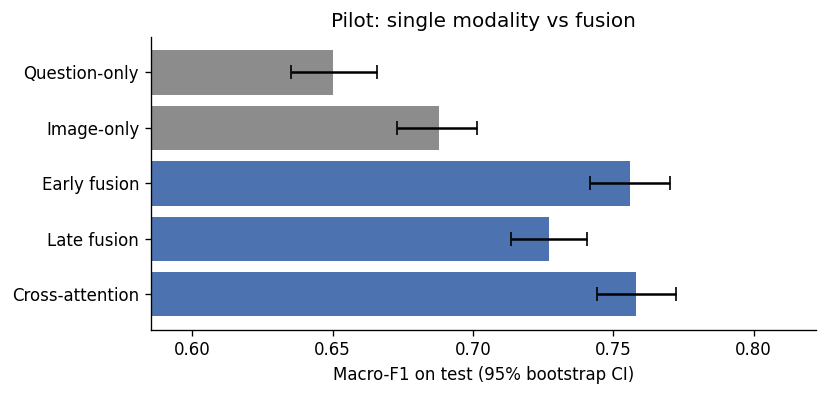

# Flagging Unanswerable Visual Questions with Image-Text Fusion

**Group 4**, Multimodal Data Fusion, Adelaide University, Semester 2 2026

Blind and low-vision people photograph objects and ask spoken questions about them, but about 28% of those questions cannot be answered from the photo because it is blurred, mis-framed or misses the object (Gurari et al. 2018). This project predicts whether a question is answerable from the **photo and question together**, comparing early, late, cross-attention and gated fusion against single-modality baselines.

[](https://colab.research.google.com/github/vishnuvardhan0ffl/vizwiz-answerability-fusion/blob/main/notebooks/01_vizwiz_pilot.ipynb)

## Status

- [x] Pilot analysis for the Assignment 2.1 proposal: [`notebooks/01_vizwiz_pilot.ipynb`](notebooks/01_vizwiz_pilot.ipynb)
- [x] Shared training code for Project 2.2 (`src/`, `configs/`)
- [ ] Full experiments, evaluation and bias analysis for Project 2.2

## Pilot results

Official validation split (4,319 pairs), one seed, frozen ViT-B/16 and BERT-base features. Positive class = unanswerable.

| Model | Macro-F1 (95% CI) | AUROC | AUPRC |
|---|---|---|---|
| Question-only | 0.650 (0.635 to 0.666) | 0.732 | 0.565 |
| Image-only | 0.688 (0.673 to 0.701) | 0.763 | 0.613 |
| Late fusion | 0.727 (0.714 to 0.741) | 0.825 | 0.696 |
| Early fusion | 0.756 (0.742 to 0.770) | 0.851 | 0.732 |
| Cross-attention | 0.758 (0.744 to 0.772) | 0.855 | 0.737 |

Cross-attention beat the best single-modality model by 0.070 macro-F1 (paired bootstrap 95% CI 0.055 to 0.087), and 39.6% of validation pairs were classified correctly by only one of the two single-modality models. On a free-tier Colab T4, feature extraction took 4.9 min with 0.94 GB peak VRAM, and a cross-attention epoch took 3.9 s.



More figures: [data characterisation](results/figures/pilot_eda.png) | [learning curves](results/figures/pilot_learning_curves.png)

## Data

VizWiz-VQA, released under a Creative Commons Attribution 4.0 International licence (VizWiz n.d.). The data is **not stored in this repository**; the notebook downloads it from the official source.

| Split | Pairs | Pilot (2.1) | Project (2.2) |
|---|---|---|---|
| Official train | 20,523 | 90% train / 10% dev | Train |
| Official validation | 4,319 | Test | Dev (tuning, thresholds) |
| Official test | 8,000 | Not used | Test (annotations released April 2026) |

## Reproduce the pilot

1. Open the notebook in Colab with the badge above.
2. Runtime > Change runtime type > **T4 GPU**, then Runtime > **Run all**, and allow Google Drive access.
3. The first run downloads about 15 GB of images and caches features to `MyDrive/vizwiz_fusion/` (about 3.5 GB). Later runs reuse the cache and finish in minutes.

All settings are in the `CONFIG` cell; outputs go to `results/`, `figures/` and `features/` in that Drive folder.

## Train the Project 2.2 models

In Colab with a T4 GPU, open `notebooks/02_run_training.ipynb` and run all cells, or from the repo root:

```
python scripts/convert_pilot_cache.py                         # once: builds features/trainval
python -m tests.test_smoke                                    # quick check (CPU, under a minute)
python -m src.train --config configs/default.yaml --model all
```

Each model and seed writes to `MyDrive/vizwiz_fusion/runs/<model>/seed<k>/`. Formats are in [`docs/data_contract.md`](docs/data_contract.md).

## Repository structure

```
configs/default.yaml              all settings and seeds for Project 2.2
src/data.py                       loads feature parts and assigns train / dev / test
src/models.py                     baselines, early fusion, cross-attention, gated fusion
src/train.py                      shared training loop (python -m src.train)
scripts/convert_pilot_cache.py    turns the pilot feature cache into features/trainval
tests/test_smoke.py               end-to-end check on synthetic data
docs/data_contract.md             feature, prediction and run-folder formats
notebooks/
    01_vizwiz_pilot.ipynb         pilot analysis (Assignment 2.1)
    02_run_training.ipynb         Colab runner for the shared training loop
results/figures/                  pilot figures
requirements.txt
README.md
```

## Ethics

Only code and aggregate results are shared here: no images, questions or annotations are redistributed. Example photos shown in the report or presentation are attributed to the VizWiz dataset. See the proposal for the bias and privacy assessment.

## Licence

Code: MIT (see `LICENSE`). Data: Creative Commons Attribution 4.0, owned by the VizWiz team (VizWiz n.d.).

## References

Full reference list (Harvard University of Adelaide style) is at the end of the notebook. Sources cited in this README:

Gurari, D, Li, Q, Stangl, AJ, Guo, A, Lin, C, Grauman, K, Luo, J & Bigham, JP 2018, 'VizWiz grand challenge: answering visual questions from blind people', in *Proceedings of the IEEE conference on computer vision and pattern recognition (CVPR)*, IEEE, Salt Lake City, USA, pp. 3608-3617.

VizWiz n.d., *Visual question answering*, VizWiz, viewed 20 October 2026, <https://vizwiz.org/tasks-and-datasets/vqa/>.
